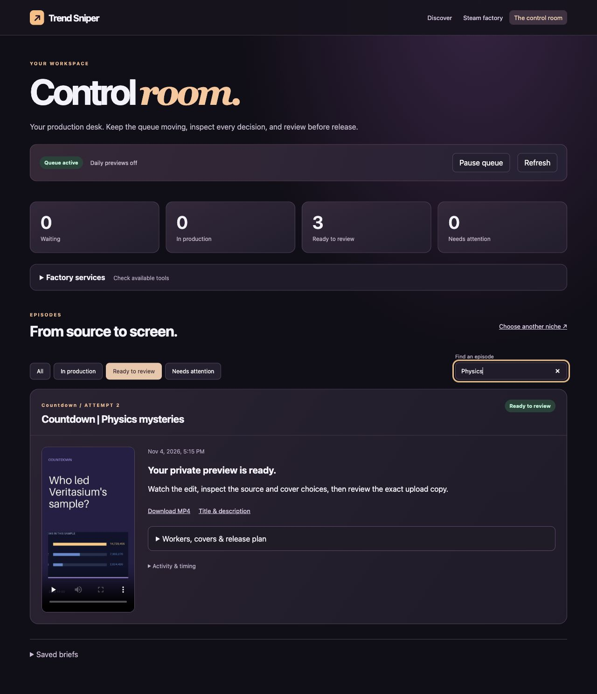

# Trend Sniper Factory

A local-first creator platform: **discover niches → analyze opportunities → develop original ideas and scripts → assemble video and sound → review → publish → learn from results**.

The goal is a browser dashboard that runs the workflow without asking a development chat to make each video. Designed for one creator, minimal recurring costs and limited time. Gaming Shorts are the first use case; DONT SPLASH and Poppy Playtime are example subjects, not fixed niches or verified growth opportunities.



## Footage-led explainer fixture

**Production studio** retains a sourced water-in-microgravity collection. Its curated path includes a reusable brief, voice-delivery auditions, editable narration and shot decisions, licensed-source records, smooth prominent footage, measured speech, phrase captions and a private editorial review. This is one curated collection; unsupported topics and missing media are visible. Publishing is disabled for the pilot. [Workflow, validation and limitations](docs/footage-explainer-pilot.md).

## Production workers

[Research and automation plan](docs/product/AUTOMATION.md) · [Worker operations, media licenses and release scheduling](docs/product/OPERATING.md)

Choose a niche, then **Produce video automatically**. The remote worker researches an original explanation, writes and checks source support, records Kokoro narration, searches licensed footage, inspects and cuts matching moments, revises unsuccessful scenes and assembles a complete preview. The creator reviews the finished result. Source downloads and rendering stay off the desktop. [Current workflow, budgets and hosting prerequisite](docs/autonomous-remote-production.md).

## Start the dashboard

```sh
python3 -m venv .venv
source .venv/bin/activate
pip install -e ".[web,test]"
trend-sniper serve
```

Open **http://127.0.0.1:8765**. After installation, macOS users can double-click `start.command` to start the server and open a browser. Keep its terminal running while using the app; Ctrl+C stops it. Windows users activate `.venv\Scripts\activate` instead.

To explore a finished edit without configuring a cloud worker, watch the [bundled demo](examples/demo/short.mp4). In the dashboard, **Discover** shows dated niche evidence, **Production studio** holds the curated explainer, and **The control room** shows jobs and the cloud connection status. A fresh checkout has an empty job history.

## What works today

The homepage is a scrolling niche explorer built from dated public YouTube channel observations. Picks span gaming, education, news, stories and other subjects. Each shows its production format, reference images, original video links, source date and measured lifetime pace or change between observations. Discovery covers a seeded channel set. An observed audience for reference material is not proof of demand for the adapted format. Scans refresh daily while the app runs.

Default topic jobs dispatch to an authenticated remote worker. They use subject evidence rather than competitor view counts, measured narration, multiple footage shots where appropriate, smooth 720×1280/24fps assembly, phrase captions and retained source/license/hash records. A missing shot triggers alternate searches or a revised script/visual concept. After bounded retries, failure is visible; slides are never silently substituted for a footage video.

**Hosting is a prerequisite, not yet a verified deployment.** Open Control room → Factory services → Remote production worker. Enter a Hugging Face write token only in the local password field. The app uploads application source and requests private CPU Basic hardware; it never purchases a subscription or upgrades hardware. Current Hugging Face rules require a paid account plan to create new Docker compute Spaces, even though CPU Basic has no hourly price. Existing eligible accounts/Spaces may work. Do not buy a plan to satisfy this setup without deciding separately. The account was connected, but the free Gradio alternative failed its compatibility test and is paused. Its adapter is disabled. Full hosted rendering and arbitrary-topic quality remain unverified. Desktop media production is not a fallback.

Discovery remains seeded. **Explicit analytics report** preserves the legacy statistics renderer as an opt-in format. Licensed footage availability and automated fact/visual checks are imperfect; the finished preview still needs real editorial and rights review.

**The control room** is the production desk: pause or resume the queue, stop jobs, retry from saved inputs, inspect activity/runtime/spend, filter episodes and review completed previews. Topic jobs link to scene and editorial review. Legacy analytics reports retain script comparisons, a timed storyboard, material decisions, covers and release details. Waiting jobs survive a restart. Interrupted remote jobs reconnect using their saved worker identity. Other interrupted jobs retain inputs for an explicit retry. Run one local server per database.

Daily production is opt-in and skips reused source sets; new topic jobs use the same remote workflow. Scheduling requires owner OAuth and review of the exact finished artifacts, audience and disclosure. The transport is implemented but has only been tested with simulated uploads. Live analytics ingestion is not connected. A saved credential is shown separately from verified access.

The Steam chart renderer remains available within the same homepage at `/#steam`. It produces original chart graphics from dated Steam observations. Previous manual briefs are preserved inside the control room.

## Optional local fixture voice

```sh
pip install -e ".[voice]"
trend-sniper install-voice
```

This developer-only local setup downloads the pinned Kokoro-82M int8 model and voice bank (about 120 MB), using the selected `af_heart` voice offline. No cloud account, per-character fee or production-time download is involved. Production studio offers steady/brisk delivery auditions; earlier Piper auditions are invalidated. Topic explainers require narration. The control-room off/auto/required preference remains for legacy analytics jobs; it cannot silently remove speech from a footage explainer. [Current setup and verification](docs/kokoro-footage-workflow.md).

## The essential platform

| Area | Purpose |
| --- | --- |
| Discover & analyze | Find accessible niches and breakout topics; show sources, velocity, competition and confidence |
| Ideas & scripts | Develop an original hook and payoff; produce an editable timed script, storyboard and audio cues |
| Media & sound | Select permitted visuals, voices, effects, meme-style stings and music for specific moments |
| Production | Run durable jobs, assemble shots, mix audio, add captions, preview, retry and track cost |
| Review & publishing | Check the exact output, audience and rights; privately upload and schedule approved work |
| Results | Compare actual same-age performance and cost; feed evidence into the next idea |

Read the [product direction and ordered build plan](docs/product/PLATFORM.md). The implemented production slice is described in the [automation plan](docs/product/AUTOMATION.md).

## Current stack

Buildless HTML/CSS/JavaScript interface, Python FastAPI service and SQLite. This first slice avoids a Node installation or frontend build; all static assets ship inside the Python package. The earlier React interface proposal is deferred until component complexity justifies it. No web font, CDN, paid provider or cloud database is used.

The desktop server binds only to `127.0.0.1`, restricts Host headers and cross-origin writes, and serves same-origin assets with a content security policy. It is a **single-user local tool without authentication**, not a public hosting configuration. Do not expose it through a tunnel or bind it to a public interface.

App data is stored in ignored `local-data/control-room.sqlite3` relative to the launch directory. Choose another database with `trend-sniper serve --db PATH` or the exported `TSF_DB_PATH` environment variable. `.env` files are not automatically loaded. Stop the server before copying the SQLite database for backup; keep backups private and outside Git. QA runs use a separate database under ignored `work/`. A fresh checkout starts without production jobs or a channel connection.

## Check the project

```sh
python -m unittest discover -s tests -v
```

The suite covers media roundtrip, validated briefs, source-grounded cuts, cover generation, licensed fragment/audio selection, queue capacity, restart recovery, concurrent retries, cancellation and review-bound publishing with simulated transport. Browser QA covers the choose → pause → cancel → retry → resume → private-preview journey and readable edit review. See [production-desk verification](docs/factory-operations-validation.md).

## Existing renderer

For installation, commands, output format, batch generation and local review/queue usage, see the [render engine guide](docs/render-engine.md). These are developer commands, not the finished platform interface. No new video is generated just by opening this project or reading the docs.

## Development workflow

Every feature starts on a named branch. Commit and push meaningful working increments, run relevant checks, then open a pull request. See [CONTRIBUTING.md](CONTRIBUTING.md) and [AGENTS.md](AGENTS.md). No artificial commits, backdating or empty pushes.

Current milestone on `feat/autonomous-remote-production`: remote dispatch, bounded autonomous research/retrieval/revision and streamed finished-preview review. Protocol and automation tests pass; a complete hosted video is blocked by compatible hosting. The private free-host experiment failed and is paused. Next: verify that exact production path on the saved Minecraft request before expanding formats.

The control room now supports pause/resume, cancellation, retries from saved sources, activity history and searchable previews. The worker report shows leading script candidates and a timed storyboard with source/audio decisions. [Operating guide](docs/product/OPERATING.md) · [Verification](docs/factory-operations-validation.md).

## Rights, cost and honest scope

All production assets must carry permission evidence; popular meme sounds are not automatically free to reuse. Default to owned, licensed or original synthesized audio. An asset licensed only for YouTube's native Shorts creation flow cannot be assumed usable in an exported MP4.

Originality, audience designation and publication decisions require real review. No trend, monetization or income guarantees. Paid provider calls must be optional, budgeted and visible. Source code is MIT; dependencies retain their own licenses. See [third-party notices](THIRD_PARTY_NOTICES.md), [research](docs/research.md) and [baseline validation](docs/validation.md).

### Format studio

The homepage distinguishes discovery from subject content. Default production uses remote research, Qwen2.5 7B writing/editing, Moondream scene checks and the selected Kokoro voice. Unavailable services or exhausted revisions fail visibly. Local Ollama subject planning remains a developer fixture. No built-in fictional story or upload leaderboard is substituted for a topic explanation. The old recipes are retained as legacy components, not the default.

Daily scans compare the same videos across snapshots when available. Initial picks use lifetime views per day. Source-channel attention is a proxy for the proposed format, particularly when adapting family fiction for older viewers.
