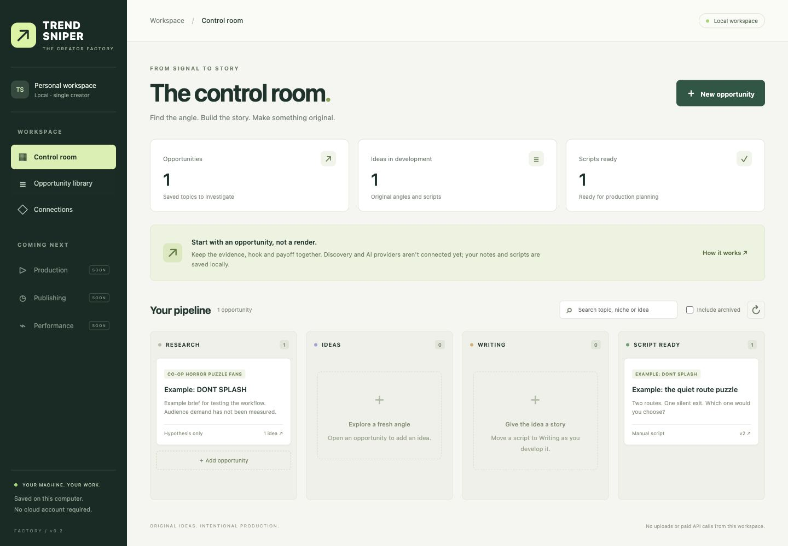

# Trend Sniper Factory

A local-first creator platform: **discover niches → analyze opportunities → develop original ideas and scripts → assemble video and sound → review → publish → learn from results**.

The goal is a browser dashboard that runs the workflow without asking a development chat to make each video. Designed for one creator, minimal recurring costs and limited time. Gaming Shorts are the first use case; DONT SPLASH and Poppy Playtime are example subjects, not fixed niches or verified growth opportunities.



## Production workers

[Research and automation plan](docs/product/AUTOMATION.md) · [Worker operations, media licenses and release scheduling](docs/product/OPERATING.md)

Choose a niche and produce a private preview. New discovery runs retain competing scripts, scene material decisions, twelve covers and a release-time proposal. The control room exposes the worker report. Daily previews and reviewed owner-channel scheduling are optional.

## Start the dashboard

```sh
python3 -m venv .venv
source .venv/bin/activate
pip install -e ".[web,test]"
trend-sniper serve
```

Open **http://127.0.0.1:8765**. After installation, macOS users can double-click `start.command` to start the server and open a browser. Keep its terminal running while using the app; Ctrl+C stops it. Windows users activate `.venv\Scripts\activate` instead.

## What works today

The homepage is a scrolling niche explorer. It groups recent YouTube channel feed observations into editorial directions, interleaves categories, links thumbnail previews and original videos, and saves the selected niche for the production milestone. A background task checks for a due scan every ten minutes while the server is running and refreshes observations after 24 hours. Pace measures lifetime views divided by upload age (minimum one day), summarized by the group median. The feed ends when all observed niches have been shown.

The separate Steam factory at `/steam` opens with three Steam chart observations. Each card shows its game, genre, peak player count, chart movement and source date. The app ships a real November 2 snapshot, refreshes an older snapshot on open and offers **Scan again**. It retains the last dated scan when Steam is unavailable. Recommendations reflect Steam chart activity. YouTube audience demand and Roblox coverage are outside this first feed.

Choose **Produce Short** to create a 14-second original chart reveal or animated comeback with synthesized sound, timed captions, title and description. A local worker renders in the background and stores its status alongside the workspace. Repeat clicks reuse the same job. Interrupted jobs can be retried after restart. Run one server per database. Preview the MP4 and download it or its metadata under **Your productions**.

The previous manual workspace is accessible under **The control room**. Publishing still requires a separate reviewed workflow.

## The essential platform

| Area | Purpose |
| --- | --- |
| Discover & analyze | Find accessible niches and breakout topics; show sources, velocity, competition and confidence |
| Ideas & scripts | Develop an original hook and payoff; produce an editable timed script, storyboard and audio cues |
| Media & sound | Select permitted visuals, voices, effects, meme-style stings and music for specific moments |
| Production | Run durable jobs, assemble shots, mix audio, add captions, preview, retry and track cost |
| Review & publishing | Check the exact output, audience and rights; privately upload and schedule approved work |
| Results | Compare actual same-age performance and cost; feed evidence into the next idea |

Read the [product direction and ordered build plan](docs/product/PLATFORM.md). The implemented production slice is described in the [automation plan](docs/product/AUTOMATION.md).

## Current stack

Buildless HTML/CSS/JavaScript interface, Python FastAPI service and SQLite. This first slice avoids a Node installation or frontend build; all static assets ship inside the Python package. The earlier React interface proposal is deferred until component complexity justifies it. No web font, CDN, paid provider or cloud database is used.

The server binds only to `127.0.0.1`, restricts Host headers and cross-origin writes, and serves same-origin assets with a content security policy. It is a **single-user local tool without authentication**, not a public hosting configuration. Do not expose it through a tunnel or bind it to a public interface.

App data is stored in ignored `local-data/control-room.sqlite3` relative to the launch directory. Choose another database with `trend-sniper serve --db PATH` or the exported `TSF_DB_PATH` environment variable. `.env` files are not automatically loaded. Stop the server before copying the SQLite database for backup; keep backups private and outside Git. The browser QA example on the development machine is explicitly labeled “Example”; a fresh checkout/database starts empty.

## Check the project

```sh
python -m unittest discover -s tests -v
```

The automated suite covers real media roundtrip, persistence after a new app instance, evidence validation, archival behavior, script readiness, version history, stale edits, export, local-request boundaries and static files. Browser QA covers create/edit/save/reload, search, library navigation, version history and the actual downloaded JSON on mobile/desktop breakpoints. See [control-room verification](docs/control-room-validation.md).

## Existing renderer

For installation, commands, output format, batch generation and local review/queue usage, see the [render engine guide](docs/render-engine.md). These are developer commands, not the finished platform interface. No new video is generated just by opening this project or reading the docs.

## Development workflow

Every feature starts on a named branch. Commit and push meaningful working increments, run relevant checks, then open a pull request. See [CONTRIBUTING.md](CONTRIBUTING.md) and [AGENTS.md](AGENTS.md). No artificial commits, backdating or empty pushes.

Current milestone is the complete local worker run on `feat/production-workers`. Live channel authorization and audience measurement remain account-dependent.

## Rights, cost and honest scope

All production assets must carry permission evidence; popular meme sounds are not automatically free to reuse. Default to owned, licensed or original synthesized audio. An asset licensed only for YouTube's native Shorts creation flow cannot be assumed usable in an exported MP4.

Originality, audience designation and publication decisions require real review. No trend, monetization or income guarantees. Paid provider calls must be optional, budgeted and visible. Source code is MIT; dependencies retain their own licenses. See [third-party notices](THIRD_PARTY_NOTICES.md), [research](docs/research.md) and [baseline validation](docs/validation.md).

### Format studio

The current homepage filters daily observations to five automatic production recipes. Family drama, later-life letters and block-world quests use the local Ollama model `llama3.2:3b` when available. A built-in authored episode covers an offline model. News desk attributes dated headline cards to the reporting channel. Countdown ranks the observed reference uploads by recorded views. Source thumbnails stay in the research interface. Each output uses original motion graphics, on-screen text and synthesized sound. Select a card and press **Produce a Short** to queue the MP4. Publishing and audience review remain separate.

Daily scans compare the same videos across snapshots when available. Initial picks use lifetime views per day. Source-channel attention is a proxy for the proposed format, particularly when adapting family fiction for older viewers.
