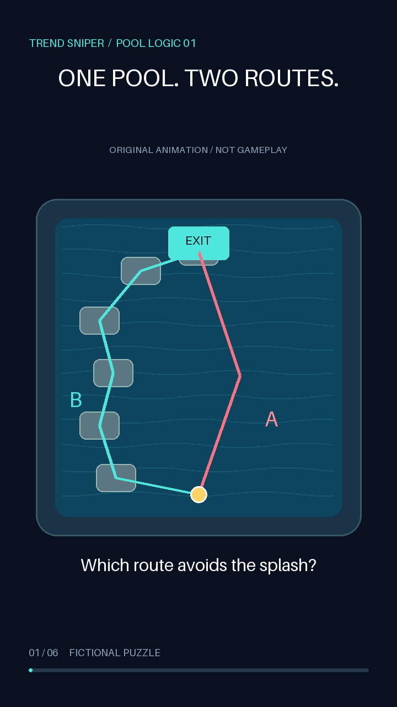

# Trend Sniper Factory

**Working local MVP:** a JSON script becomes an original 25-second vertical Short, with procedural animation, synthesized sound, captions, title, description, hashtags and an asset provenance manifest. No gameplay capture, editing session, paid API, model download or account required.

Built as a student portfolio project: reproducible media generation, subprocess streaming, artifact integrity checks, a human review gate and CI. It does not promise virality, income or YouTube monetization.

[Watch the generated demo](../examples/demo/short.mp4) · [Inspect its manifest](../examples/demo/manifest.json)



## Run in five minutes

Python 3.11+ on macOS, Linux or Windows. Initial installation needs internet to download Pillow and the platform FFmpeg wheel; rendering then works offline. Example commands use macOS/Linux (Windows: `.venv\Scripts\activate`).

```sh
python3 -m venv .venv
source .venv/bin/activate
pip install -e .
trend-sniper render --topic topics/dont-splash.json --out renders/first
```

Open `renders/first/short.mp4`. Output is 720×1280, 9:16, 24 fps, H.264/yuv420p + AAC, fast-start MP4. The renderer decodes the whole finished video to check for encoding errors. Use a fresh output directory on each run; existing deliverables are never overwritten.

The included English-language episode is an **original pool-route puzzle inspired by DONT SPLASH / Roblox**, explicitly labeled as animation rather than gameplay. Its fictional puzzle rules are not claims about the game. All art consists of code-drawn geometry. Sound is generated from oscillators; **there is no narrator in v0.1**. DONT SPLASH is a user-selected hypothesis, not a measured fast-growing trend.

## Files produced

| File | Purpose |
| --- | --- |
| `short.mp4` | Finished video with burned-in text and audio |
| `poster.png` | First-frame preview |
| `script.json` | Exact episode input |
| `metadata.json`, `metadata.txt` | Upload copy; pending review, private by default |
| `captions.srt` | Timed script captions |
| `soundtrack.wav` | Original generated audio |
| `manifest.json` | Hashes, provenance, runtime, API spending |
| `ffmpeg-version.txt`, `ffmpeg.log` | Encoder configuration and diagnostics |

## Topics and series

Copy the JSON topic and change the id, editorial premise, title, description and scenes. Scene modes currently belong to the **pool puzzle renderer**: `choice`, `rule`, `splash`, `safe`, `reveal`, `end`. Each scene lasts 1–12 seconds; total is capped at 60 seconds. ASCII English text is recommended with the bundled font; another language needs a licensed font via `TSF_FONT`.

```sh
trend-sniper batch --topics topics/dont-splash.json topics/your-original-episode.json --out renders/series
```

Supply distinct IDs and substantively different scripts. Batch processes the supplied scripts sequentially; it does not invent, scrape or approve scripts. If a job fails, completed folders remain available; rerun only failed topics into fresh folders. The scene geometry is fixed in v0.1. **Changing the topic label to Poppy Playtime does not create a suitable Poppy episode**; that needs its own original visual treatment and factual review. Do not publish cosmetic variations of the same template at scale.

## Review and local queue

Watch the whole MP4, read its metadata, check claims/rights and decide audience. Only then run:

```sh
trend-sniper approve renders/first --audience made_for_kids --reviewer YOUR_NAME
trend-sniper enqueue renders/first --at 2027-01-10T18:00:00+08:00 --queue queue.json
```

The audience above is an example, **not a determination for your channel**. Select `not_made_for_kids` only when supported by the actual intended audience and content. Being about Roblox does not settle the question either way; mixed-audience content directed at children can still be made for kids.

Approval records hashes of the video, script, captions, metadata and manifest. Changing those files invalidates approval. Duplicate video hashes are rejected. A future timezone-aware timestamp is required. The queue is a single-user JSON file, **not a running scheduler**; it records `ready_for_manual_upload` and never calls YouTube. Do not run concurrent writers. There is no background service.

## Configuration and costs

No `.env` is required. `.env.example` documents optional environment variables; `.env` is not loaded automatically. Export variables in your shell if needed. `IMAGEIO_FFMPEG_EXE` can select your installed encoder; it must support libx264 and AAC. `TSF_FONT` selects a font you have rights to use. Never commit OAuth files or tokens.

This episode makes **zero paid API calls**. Runtime is recorded in `manifest.json`; electricity, hardware, installation downloads and your editorial time are not free and are not priced. There is no revenue estimate.

## Verification

```sh
python -m unittest discover -s tests -p test_pipeline.py -v
trend-sniper render --topic topics/dont-splash.json --out renders/smoke
```

Tests include a real two-second MP4 roundtrip and cover malformed scripts, missing/stale approval, duplicate queue entries and schedule validation. GitHub Actions runs tests and a full render on Python 3.11/3.14 Linux. Locally verified on Python 3.14/macOS ARM; hosted CI is configured, not yet run. No credentials are required.

## Next milestone (not implemented)

1. Add a second original renderer and distinct episode briefs; evaluate the first video's hook and legibility before producing a series.
2. Add explicit YouTube desktop OAuth, minimal upload scope, private resumable upload, protected/revocable token storage and failure recovery. Never use a service account for a personal channel.
3. Add review-bound scheduling with persisted remote video ID, idempotency and reconciliation after uncertain network failures. A worker must recheck hashes, audience and permissions immediately before upload. YouTube's API supports `status.publishAt` with private videos; verify current account/project restrictions before enabling public scheduling.
4. Add read-only owner-authorized analytics: timestamped view snapshots, watch time and retention where available, per-video cost and comparison at equal publication age. No fabricated sample performance or revenue data.
5. Add trend evidence from permitted official APIs, storing observation timestamps and multiple samples. A single view count is not growth evidence. Avoid scraping or inventing a “trend score”.

The first milestone is usable without account access. OAuth upload, live trend discovery and channel analytics remain future work, not hidden features.

## Rights and platform policy

See [THIRD_PARTY_NOTICES.md](../THIRD_PARTY_NOTICES.md) for libraries, fonts and FFmpeg licensing, and [docs/research.md](research.md) for primary sources checked on 2026-11-03. Source code is MIT; third-party licenses retain their own terms. No third-party game media is bundled. Roblox and game names are used descriptively, with no affiliation implied.

Original generated visuals do not guarantee monetization. YouTube reviews repetitive/mass-produced content as well as reused content. Review factual claims, audience designation, misleading metadata and any applicable synthetic-media disclosure before publishing. Stylized procedural animation does not by itself determine the platform's altered-content disclosure setting. `containsSyntheticMedia` in our metadata is a local provenance field, not a finalized YouTube API request.
